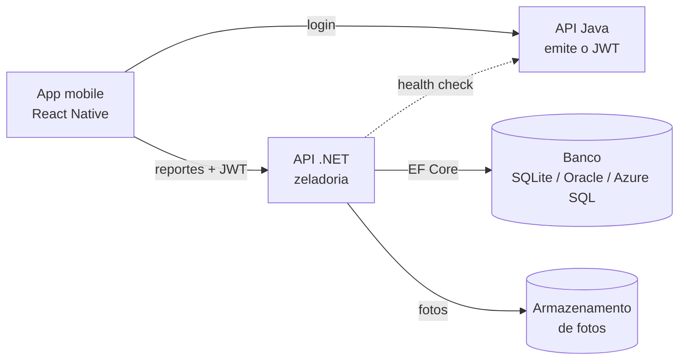

# Voz & Via - API de Zeladoria (.NET)

API da parte de zeladoria colaborativa do Voz & Via, projeto da Global Solution 2026/2 (tema CitizenTech) da FIAP.

O Voz & Via ajuda pessoas idosas e pessoas com deficiência a circular pela cidade com mais autonomia. Nesta API, o cidadão reporta barreiras e problemas nos espaços públicos (calçada quebrada, rampa ausente, buraco, poste apagado, semáforo sonoro com defeito, lixo) com descrição, localização e foto. O gestor do órgão público responsável vê os reportes em uma fila ordenada por prioridade e atualiza o andamento, e o cidadão acompanha cada mudança de status pelo app.

O problema é real: segundo o Censo 2022 do IBGE, só 18,8% dos moradores urbanos vivem em ruas com calçada livre de obstáculos, e a maioria vive em ruas sem nenhuma rampa para cadeirantes. A API transforma a reclamação solta em uma demanda organizada, com protocolo, prioridade e histórico.

## Integrantes

| Nome | RM |
|---|---|
| Fabrício Henrique Pereira | 563237 |
| Henrique Sinkevicius Maran | 562977 |
| Leonardo José Pereira | 563065 |
| Miguel Henrique Oliveira Dias | 565492 |
| Pedro Henrique de Oliveira | 562312 |

## Tecnologias

- .NET 8 com ASP.NET Core **Minimal API**
- **Entity Framework Core 8** (SQLite, Oracle ou SQL Server, escolhido por configuração)
- **JWT Bearer** para autenticação e autorização por papel
- **Rate Limiting** nativo do ASP.NET Core
- **Health Checks** nativos do ASP.NET Core
- **Swagger / OpenAPI** (Swashbuckle)
- **xUnit** e **WebApplicationFactory** para testes unitários e de integração

## Arquitetura



- O **login** fica na API Java, que emite o token. Esta API **valida** o mesmo token (mesma chave, emissor e público), então o usuário faz login uma vez e usa as duas APIs.
- O usuário é sempre identificado pelo token (claim `sub`), nunca por um ID enviado no corpo da requisição.
- As tabelas seguem o contrato do banco do grupo (prefixo `VV_`). No Oracle elas são criadas pelo script do grupo, sem migrations.

Organização do código (`src/CaminhoLivre.Api`):

| Pasta | Conteúdo |
|---|---|
| `Endpoints` | Rotas da Minimal API, agrupadas por assunto |
| `Services` | Regras de aplicação (criar reporte, fila do gestor, idempotência) |
| `Domain` | Entidades e regras de negócio puras (prioridade, transições de status, protocolo) |
| `Validation` | Validação das entradas |
| `Auth` | Configuração do JWT e políticas por papel |
| `Infra` | Rate limiting e armazenamento de fotos |
| `Health` | Verificações de saúde |
| `Data` | DbContext, escolha do banco e dados iniciais |

## Requisitos da disciplina e onde estão

| Requisito | Como foi atendido |
|---|---|
| Minimal API RESTful, validações, códigos HTTP e Swagger | Endpoints em `Endpoints/`, validações em `Validation/`, respostas 200, 201, 204, 400, 401, 403, 404, 409, 422 e 429 documentadas no Swagger |
| JWT protegendo endpoints | Políticas `Cidadao` e `Gestor`; o token é validado (assinatura, emissor, público e validade) |
| Idempotência | Cabeçalho `Idempotency-Key` obrigatório em `POST /api/reportes` |
| Rate limiting com 429 | 60 requisições por minuto por usuário e 5 criações de reporte por minuto, com cabeçalho `Retry-After` |
| Testes unitários e de integração com xUnit | Projeto `tests/CaminhoLivre.Tests`, pastas `Unitarios` e `Integracao` |
| Health checks | `/health` verifica banco, armazenamento de fotos e a API Java (serviço externo) |

## Como executar

Pré-requisito: [.NET 8 SDK](https://dotnet.microsoft.com/download/dotnet/8.0).

```bash
git clone https://github.com/Fabriciopereira-sp/DOTNET_GS.git
cd DOTNET_GS
dotnet run --project src/CaminhoLivre.Api
```

O Swagger abre em `http://localhost:5080/swagger`. No primeiro uso a API cria sozinha o banco SQLite com órgãos, categorias e usuários de teste. Não é preciso instalar banco nenhum.

### Testar no Swagger

1. Em **Token de teste**, chame `POST /api/dev/token` com um dos usuários abaixo.
2. Copie o `token` da resposta, clique em **Authorize** e cole o token.
3. Chame os endpoints. Para criar um reporte, preencha o cabeçalho `Idempotency-Key` com qualquer texto único (por exemplo, um UUID).

| Usuário de teste | Papel | Órgão |
|---|---|---|
| `maria@teste.com` | CIDADAO | |
| `joao@teste.com` | CIDADAO | |
| `gestor.obras@teste.com` | GESTOR | Secretaria de Obras |
| `gestor.iluminacao@teste.com` | GESTOR | Iluminação Pública |

O endpoint de token de teste só existe em ambiente de desenvolvimento (ou com `Auth__HabilitarTokenDeTeste=true`). Em produção o token vem do login da API Java.

### Rodar os testes

```bash
dotnet test
```

### Docker

```bash
docker build -f dockerfiles/Dockerfile -t voz-e-via-dotnet .
docker run -p 8080:8080 -e JWT_SECRET="<chave com 32 ou mais caracteres>" voz-e-via-dotnet
```

## Configuração (variáveis de ambiente)

Nenhuma senha ou chave fica no código. Tudo vem de variáveis de ambiente:

| Variável | Para que serve | Padrão |
|---|---|---|
| `JWT_SECRET` | Chave do JWT, **a mesma da API Java** (mínimo 32 caracteres). Obrigatória fora de desenvolvimento | Em desenvolvimento, uma chave temporária |
| `Database__Provider` | `Sqlite`, `Oracle` ou `SqlServer` | `Sqlite` |
| `ConnectionStrings__Oracle` | Conexão do Oracle do grupo | |
| `ConnectionStrings__SqlServer` | Conexão do Azure SQL | |
| `Database__CriarTabelasAoIniciar` | `true` para a API criar as tabelas e os dados iniciais no Oracle ou SQL Server | `false` |
| `ServicosExternos__ApiJavaHealthUrl` | URL de health da API Java, usada no `/health` | |
| `RateLimit__RequisicoesPorMinuto` / `RateLimit__ReportesPorMinuto` | Limites do rate limiting | `60` / `5` |

Contrato do token (igual ao da API Java): HS256, emissor `voz-e-via-java`, público `voz-e-via`, claims `sub` (ID do usuário), `name` e `role` (`CIDADAO`, `CUIDADOR` ou `GESTOR`).

## Endpoints

| Método | Rota | Papel | O que faz |
|---|---|---|---|
| POST | `/api/reportes` | CIDADAO | Cria um reporte (exige `Idempotency-Key`) e gera o protocolo `VV-AAAA-NNNNNN` |
| GET | `/api/reportes/meus?page=0&size=10` | CIDADAO | Lista os reportes do usuário |
| GET | `/api/reportes/{id}` | dono ou GESTOR do órgão | Detalhe com histórico de status |
| PUT | `/api/reportes/{id}` | CIDADAO dono | Edita descrição e endereço enquanto ABERTO |
| DELETE | `/api/reportes/{id}` | CIDADAO dono | Cancela o reporte enquanto ABERTO |
| POST | `/api/reportes/{id}/foto` | CIDADAO dono | Envia a foto (JPEG ou PNG, até 5 MB) |
| GET | `/api/gestor/reportes?status=&urgencia=&categoria=` | GESTOR | Fila do órgão, ordenada por prioridade |
| PATCH | `/api/gestor/reportes/{id}/status` | GESTOR | Muda o status seguindo o fluxo e grava o histórico |
| GET | `/api/categorias` e `/api/categorias/{id}` | autenticado | Lista e consulta categorias |
| POST, PUT, DELETE | `/api/categorias` | GESTOR | Cria, edita e exclui categorias |
| GET | `/api/orgaos` | autenticado | Lista os órgãos |
| GET | `/health` e `/health/live` | público | Saúde da API e das dependências |

### Regras de negócio

- **Fluxo de status:** ABERTO, EM_ANALISE, EM_EXECUCAO, RESOLVIDO. O cidadão pode cancelar enquanto está ABERTO. Pular ou voltar etapa responde 409.
- **Prioridade:** peso da urgência (ALTA 100, MEDIA 50, BAIXA 10) mais 2 pontos por dia em aberto, até 30 dias. Assim um reporte antigo não fica esquecido no fim da fila.
- **Privacidade:** pedir o reporte de outra pessoa responde 404, para não revelar que o ID existe.

### Idempotência

Se a conexão cair e o app reenviar o mesmo reporte, ele não é duplicado:

- mesma chave e mesmo conteúdo: devolve a mesma resposta (mesmo protocolo), com o cabeçalho `Idempotent-Replayed: true`;
- mesma chave com conteúdo diferente: 422;
- duas requisições iguais ao mesmo tempo: só uma é processada, a outra recebe 409;
- sem o cabeçalho: 400.

As chaves ficam na tabela `VV_IDEMPOTENCIA` por 24 horas.

### Health checks

`/health` responde com o estado de cada verificação: `banco-de-dados`, `armazenamento-de-fotos` e `api-java`. Se a API Java estiver fora do ar, o resultado é **Degraded** e não **Unhealthy**, porque esta API continua atendendo com os tokens já emitidos. `/health/live` só indica se o processo está de pé.

## Integração com o grupo

- **Mobile:** consome os endpoints acima, enviando o token do login da API Java e o cabeçalho `Idempotency-Key` ao criar reportes.
- **Banco de Dados:** `scripts/oracle-tabelas-dotnet.sql` traz as tabelas da API .NET no formato que a API espera, para entrar no script do grupo.
- **DevOps:** `dockerfiles/Dockerfile` publica a API em container; o banco é escolhido por variável de ambiente (Oracle ou Azure SQL); `dotnet test` roda os testes no pipeline. CRUD completo em `VV_REPORTE` e `VV_CATEGORIA`.

## Uso de IA generativa

Usamos IA generativa como apoio na revisão de código, na explicação de erros e na revisão dos textos. Todo o código foi revisado, executado e testado pelo grupo.
